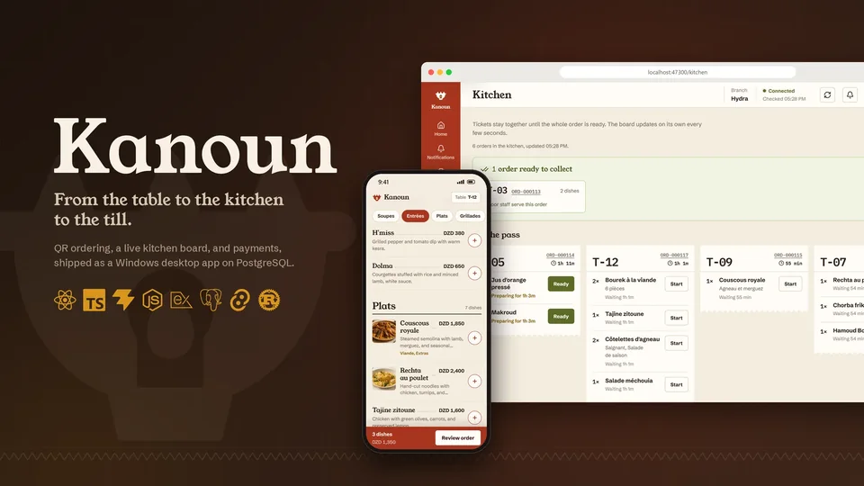
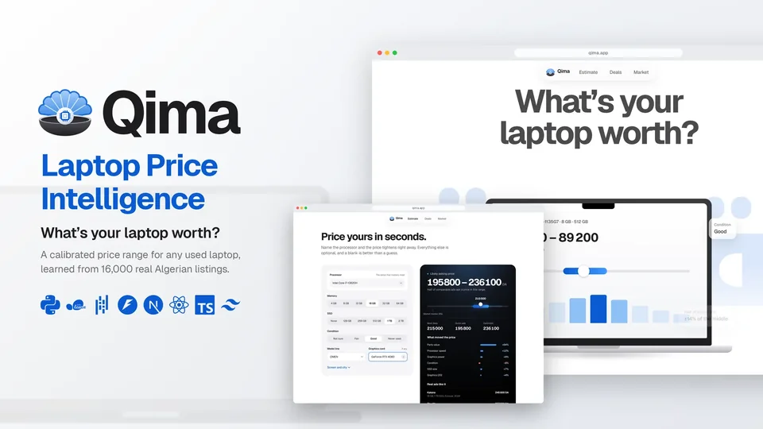
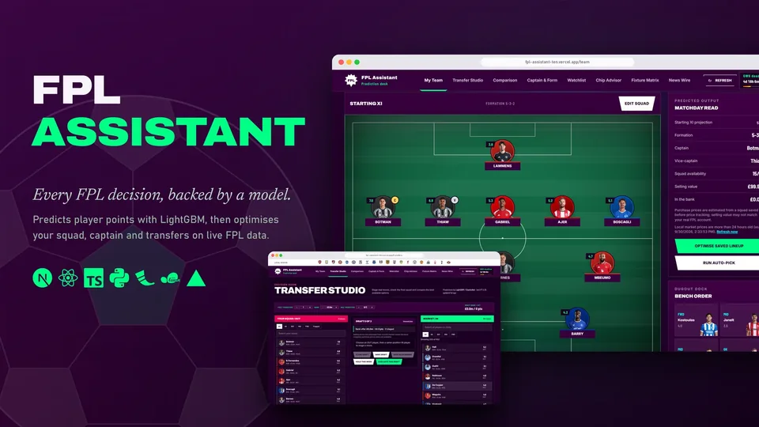
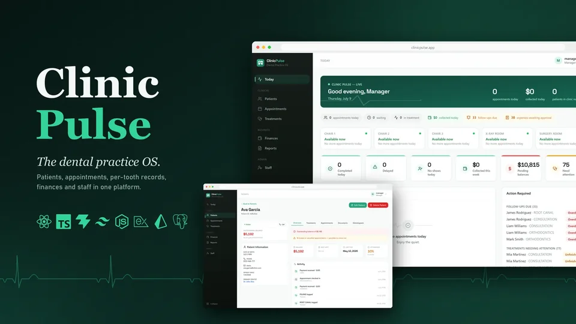
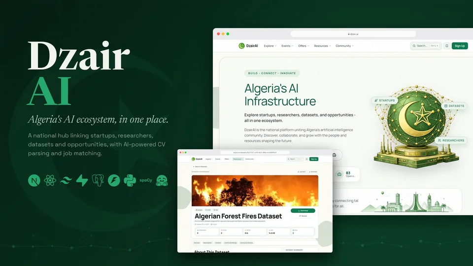
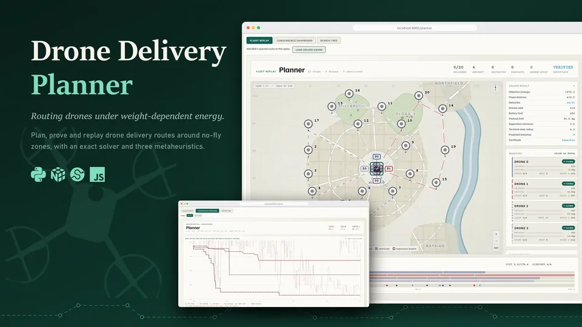
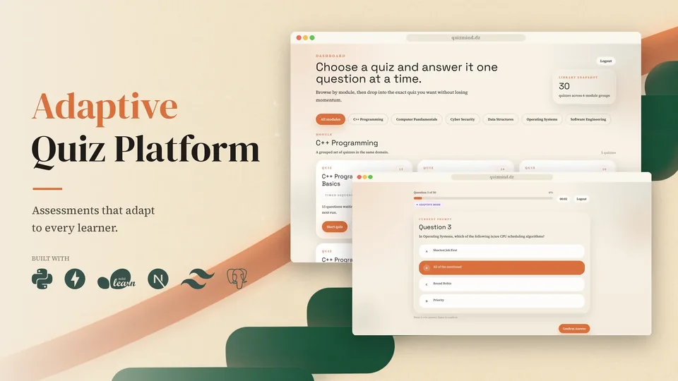
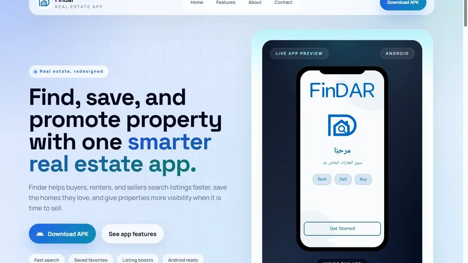

<a href="https://yahiakerroum-portfolio.vercel.app">
  <picture>
    <source media="(prefers-color-scheme: dark)" srcset="assets/banner-dark.svg">
    
  </picture>
</a>

  
  
  
  

I'm in my fourth year at ENSIA, the National Higher School of Artificial Intelligence. I give every product I build its own name and identity, and several start from everyday life in Algeria, like a restaurant kitchen, the used-laptop market or a house hunt.

 

<picture>
  <source media="(prefers-color-scheme: dark)" srcset="assets/h-work-dark.svg">
  
</picture>

<table>
  <tr>
    <td width="50%" valign="top">
      
      <h3>Kanoun</h3>
      A restaurant operating system: QR table ordering, live kitchen tickets, payments and a back office, shipped as a Windows desktop app.
      
<b>Built alone</b> · TypeScript · Tauri · PostgreSQL

      <a href="https://yahiakerroum-portfolio.vercel.app/work/kanoun">Case study</a> · <a href="https://github.com/YahiaKerroum/Kanoun">Code</a>
    </td>
    <td width="50%" valign="top">
      
      <h3>Qima · قيمة</h3>
      Fair asking prices for used laptops in Algeria, learned from Ouedkniss listings, with an explanation behind every estimate and a deals finder.
      
<b>Team lead</b>; models; designed and built the platform

      <a href="https://yahiakerroum-portfolio.vercel.app/work/qima">Case study</a> · <a href="https://qima-kappa.vercel.app">Live</a> · <a href="https://github.com/khalilgh1/laptop-price-prediction">Code</a>
    </td>
  </tr>
  <tr>
    <td width="50%" valign="top">
      
      <h3>FPL Assistant</h3>
      A Fantasy Premier League desk: points forecasts, a squad optimiser, transfer and captaincy advice, and a fixture matrix.
      
<b>Main contributor</b>: models, platform design, part of the build

      <a href="https://yahiakerroum-portfolio.vercel.app/work/fpl-assistant">Case study</a> · <a href="https://fpl-assistant-ten.vercel.app">Live</a>
    </td>
    <td width="50%" valign="top">
      
      <h3>ClinicPulse</h3>
      An operating system for dental practices: a live daily dashboard, per-tooth records, appointments, finances and role permissions.
      
<b>Co-led</b> the original; rebuilt the whole platform

      <a href="https://yahiakerroum-portfolio.vercel.app/work/clinicpulse">Case study</a> · <a href="https://github.com/YahiaKerroum/Dentist-Management-System">Code</a>
    </td>
  </tr>
  <tr>
    <td width="50%" valign="top">
      
      <h3>DzairAI</h3>
      A national platform for Algeria's AI ecosystem: experts, companies, datasets, events and news, with CV parsing and job matching.
      
<b>One of the leads</b>

      <a href="https://yahiakerroum-portfolio.vercel.app/work/dzairai">Case study</a> · <a href="https://dzair.ai">Live</a>
    </td>
    <td width="50%" valign="top">
      
      <h3>Drone Delivery Planner</h3>
      Routing drones whose energy depends on the weight they carry, with exact and metaheuristic solvers and an interactive planner with flight replay.
      
<b>One of the leads</b>: pipeline and models; designed and built the planner

      <a href="https://yahiakerroum-portfolio.vercel.app/work/drone-planner">Case study</a>
    </td>
  </tr>
  <tr>
    <td width="50%" valign="top">
      
      <h3>Adaptive Quiz Platform</h3>
      Quizzes that pick the next question from how the learner is doing, and estimate their level from as few questions as possible.
      
<b>One of the leads</b>

      <a href="https://yahiakerroum-portfolio.vercel.app/work/quiz">Case study</a> · <a href="https://github.com/YahiaKerroum/QuizPlatform">Code</a>
    </td>
    <td width="50%" valign="top">
      
      <h3>FinDar</h3>
      A Flutter real-estate app for Algeria: listings, search, favourites and boosts for sellers, agencies, buyers and renters.
      
<b>Main contributor</b>; did all of the localization

      <a href="https://yahiakerroum-portfolio.vercel.app/work/findar">Case study</a> · <a href="https://fin-dar-website.vercel.app">Website</a>
    </td>
  </tr>
</table>

 

<picture>
  <source media="(prefers-color-scheme: dark)" srcset="assets/h-toolbox-dark.svg">
  
</picture>

  
   
  

Machine learning and optimisation on one side; full-stack web, mobile and desktop on the other. I speak Arabic, French and English.

 

<picture>
  <source media="(prefers-color-scheme: dark)" srcset="assets/h-hello-dark.svg">
  
</picture>

The quickest way to reach me is [yahia.kerroum@ensia.edu.dz](mailto:yahia.kerroum@ensia.edu.dz). You'll find every project above, with screenshots and the story behind it, on my [portfolio](https://yahiakerroum-portfolio.vercel.app).
